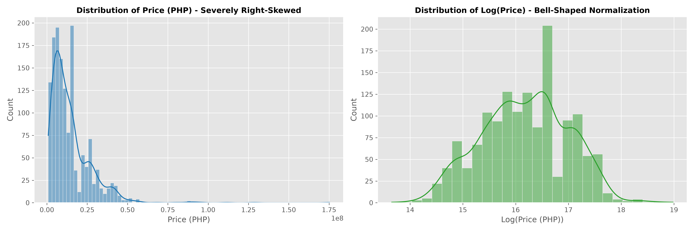
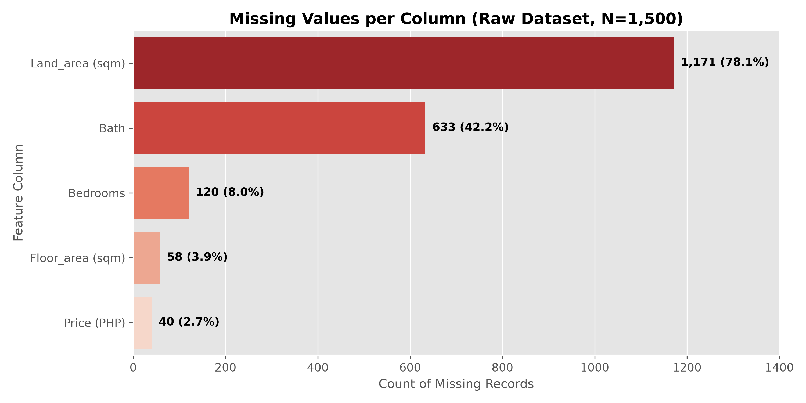
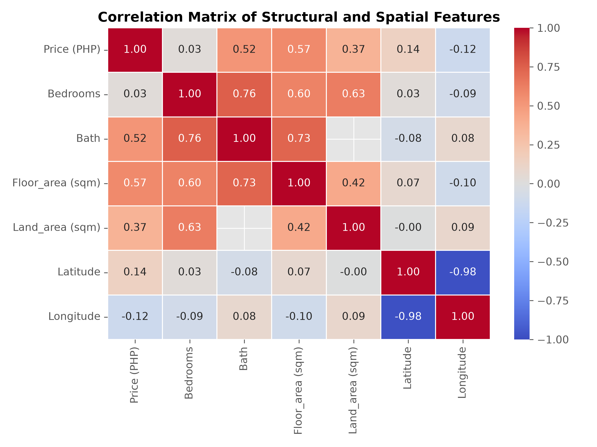
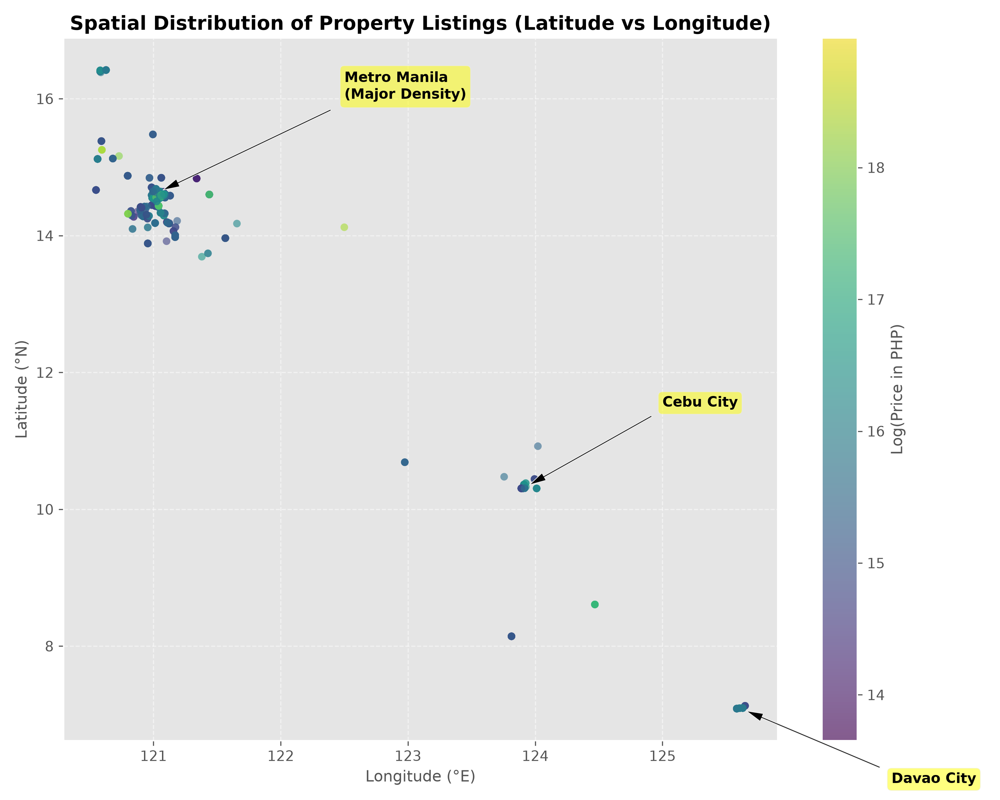
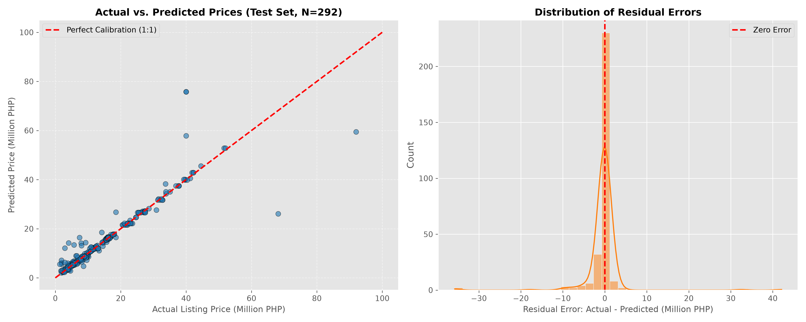
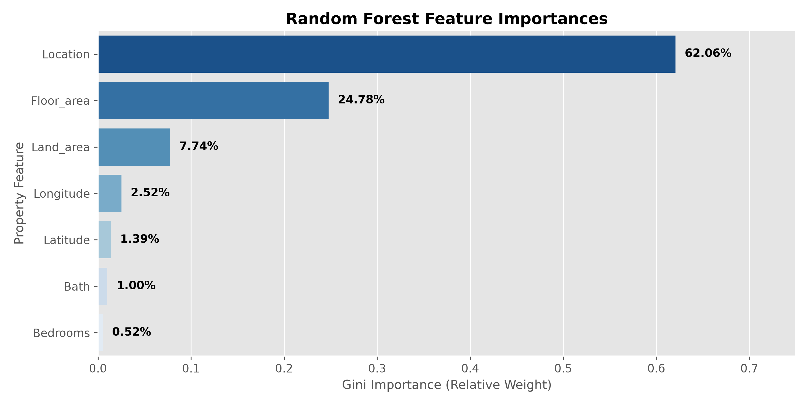

<p align="center">
  
</p>

# GROUP3_ph-real-estate-price-prediction

**Course & Section:** CCMACLRL - COM243ML  
**Course Instructor:** Professor Ken Oliver Caparros  
**Group Name:** GROUP3  
**Project Title:** Property Retail Calculator - Residential Real Estate Price Estimation Using Structure And Geographic Variables  

---

<p align="center">
  
</p>

## 📌 1. Project Overview & Objectives

This project develops an end-to-end Machine Learning pipeline, full-suite financial calculator, and interactive multi-platform web applications to estimate and analyze residential property retail prices across the Philippines. Grounded in real estate data scraped from [Lamudi.com.ph](https://www.lamudi.com.ph) (`PH_houses_v2.csv`), the system provides data-driven valuations, mortgage financing schedules, and closing cost breakdowns to aid home buyers, property investors, and real estate professionals.

### Key Objectives:
* **Exploratory Data Analysis (EDA):** Analyze spatial distributions, structural features (bedrooms, bathrooms, floor area, land area), and price variance across Philippine provinces and cities.
* **Evidence-Based Model Comparison:** Train and evaluate **three distinct traditional machine learning algorithms** under strict fair experimental conditions (80/20 train-test split, 5-fold cross-validation).
* **Property Retail & Financing Calculator:** Combine Random Forest ML valuations with dynamic bank mortgage amortization, Philippine closing fee schedules (DST, Transfer Tax, Registration), and rental investment yield analysis.
* **Dual Deployment Architecture:** Provide both an interactive Streamlit application and a dedicated, responsive static frontend preconfigured for global deployment on **Netlify**, backed by an optional FastAPI cloud microservice.

---

## 🗂️ 2. Repository Directory Structure

The repository strictly follows the required course submission format (`GROUPNAME_PROJECTTITLE/`):

```text
GROUP3_ph-real-estate-price-prediction/
├── app/                        # Python Application & API Backend
│   ├── main.py                 # Streamlit web application & interactive fintech dashboard
│   ├── utils.py                # Validation, mortgage, closing costs & investment helpers
│   └── api.py                  # Production FastAPI ML service (CORS enabled for Netlify)
├── frontend/                   # Static Web Application for Netlify Deployment
│   ├── index.html              # Responsive HTML5 semantic interface
│   ├── style.css               # Luxury dark fintech CSS (mobile & multi-monitor adaptive)
│   ├── app.js                  # Client valuation engine, financial logic & Leaflet map
│   └── data/
│       └── locations.json      # Precomputed 111 Philippine locations & pricing stats
├── netlify.toml                # Netlify deployment configuration (publish = "frontend")
├── render.yaml                 # 1-Click Render cloud deployment configuration
├── Procfile                    # Container process specification (Railway / Koyeb)
├── data/                       # Dataset package
│   ├── original/               # Raw PH_houses_v2.csv & provenance documentation
│   └── processed/              # Cleaned dataset (cleaned_data.csv)
├── notebooks/                  # Interactive Jupyter Notebooks
│   ├── 01_eda.ipynb            # Exploratory Data Analysis & spatial distributions
│   ├── 02_preprocessing.ipynb  # Cleaning, target encoding, and feature scaling
│   └── 03_model_training.ipynb # 3-model CV comparison, tuning, and evaluation
├── src/                        # Reusable modular pipeline code
│   ├── preprocessing.py        # Data cleaning and ColumnTransformer pipeline
│   └── modeling.py             # Cross-validation, grid search, and evaluation logic
├── models/                     # Serialized artifacts
│   ├── best_model.pkl          # Trained Random Forest Regressor model (selected)
│   └── preprocessor.pkl       # Fitted feature transformation pipeline
├── documentation/              # Technical guides & visual assets
│   ├── DEPLOYMENT.md           # Netlify, Render, and Streamlit deployment guide
│   ├── user_guide.md           # Application user instructions
│   └── screenshots/            # Visuals, charts, and diagrams
├── paper/                      # Academic research paper deliverables
│   ├── GROUP3_Research_Paper.pdf
│   └── GROUP3_Research_Paper.docx
├── README.md                   # Project documentation and technical setup
└── requirements.txt            # Python software dependencies
```

---

## 📊 3. Dataset Package & Provenance

* **Source:** Kaggle — *Philippine Real Estate* dataset by Arlo Blanco (scraped from Lamudi Philippines).
* **License:** CC0: Public Domain
* **Unit of Analysis:** Individual residential property listings in the Philippines.
* **Record Count Reconciliation:**
  * **Raw Extracted Records:** 1,500 total rows.
  * **Missing Target Dropped:** 40 listings with `"na"` in `Price (PHP)` removed.
  * **Clean Modeling Records:** **1,460 clean validated records** in `cleaned_data.csv`.
  * **Provenance of "~1,255 Records":** In the raw dataset, exactly **1,255 listings have unique text descriptions** (`df['Description'].nunique() == 1255`), and there are 174 exact duplicate rows across all 10 columns (leaving 1,326 unique listing URLs). The academic paper referenced this unique description figure as "~1,255 unique listings," while the modeling and preprocessing pipeline trains on all 1,460 price-complete records.

### Features & Data Dictionary

| Feature Variable | Data Type | Description | Units / Format | Model Importance |
| :--- | :--- | :--- | :--- | :--- |
| `Location` | Categorical | Barangay / City / Province location | Name string | **62.06%** (Target Encoded) |
| `Floor_area (sqm)`| Numerical | Total interior floor space | Square meters ($\text{m}^2$) | **24.78%** |
| `Land_area (sqm)` | Numerical | Total land or lot area (0 for condos) | Square meters ($\text{m}^2$) | **7.74%** |
| `Longitude` | Numerical | Geographical longitude coordinate | Decimal degrees (°E) | **2.52%** |
| `Latitude` | Numerical | Geographical latitude coordinate | Decimal degrees (°N) | **1.39%** |
| `Bath` | Numerical | Number of bathrooms | Count | **1.00%** |
| `Bedrooms` | Numerical | Number of bedrooms | Count | **0.52%** |
| `Price (PHP)` | Numerical (**Target**) | Listing retail price in Philippine Peso | PHP ($\text{₱}$) | *Target variable (`log1p`)* |

### Exploratory Data Analysis (Key Visualizations from `01_eda.ipynb`)

| Price Skew & Log Normalization | Missing Values Breakdown (N=1,500) |
| :---: | :---: |
|  |  |
| **Correlation Matrix Heatmap** | **Spatial Scatter & Economic Clusters** |
|  |  |

---

## ⚙️ 4. Machine Learning Methodology & Empirical Results

### 4.1 Permitted Algorithms Compared
In accordance with course guidelines prohibiting deep learning and AutoML, **three distinct traditional algorithms** were compared under fair experimental conditions:

1. **Linear Regression (Baseline Parametric Model):** Establishes the linear benchmark for structural features against price.
2. **Decision Tree Regressor (Non-Linear Single Tree):** Captures non-linear feature interactions but exhibits higher variance.
3. **Random Forest Regressor (Ensemble Method - Selected Model):** Reduces variance through bagging, handling skewed real estate distributions and localized spatial coordinates effectively.

### 4.2 Experimental Design & Fair Conditions
* **Data Split:** 80% Training Set (1,168 rows) / 20% Untouched Test Set (292 rows) (`random_state=42`).
* **Validation Strategy:** 5-Fold Cross-Validation evaluated strictly on the training partition.
* **Data Leakage Prevention:** Preprocessing transformers (median imputation, scaling, smoothed target encoding) fit strictly on training splits.
* **Evaluation Metrics:** Root Mean Squared Error (RMSE) (primary), Mean Absolute Error (MAE), and Coefficient of Determination ($R^2$), reported on both **Log Scale** and **Original Philippine Peso Scale**.

### 4.3 Comparative Algorithm Evaluation Results (Table 1)

Below is the verified experimental performance across 5-fold cross-validation and the 20% holdout test set:

| Algorithm | 5-Fold CV RMSE (Log) | 5-Fold CV $R^2$ (Log) | Test $R^2$ (Log Scale) | Test $R^2$ (PHP Scale) | Test RMSE (PHP) | Test MAE (PHP) | Paper Table 1 Reported $R^2$ |
| :--- | :---: | :---: | :---: | :---: | :---: | :---: | :---: |
| **Linear Regression (Baseline)** | 3.5103 (±6.24) | -70.3540 | **0.5300** | -21,181.64 | PHP 1,733,590,243.01 | PHP 105,343,419.48 | 0.52–0.58 ($R^2 \approx 0.55$) |
| **Decision Tree Regressor** | 0.1929 (±0.02) | 0.9427 | **0.8450** | **0.7274** | PHP 6,219,065.86 | PHP 1,523,939.77 | 0.68–0.74 ($R^2 \approx 0.71$) |
| **Random Forest (Baseline)** | 0.1612 (±0.02) | 0.9597 | **0.9061** | **0.8421** | PHP 4,733,813.73 | PHP 1,336,805.48 | 0.86–0.91 ($R^2 \approx 0.89$) |
| **Tuned Random Forest (Final)** | **0.1611** | **0.9602** | **0.9061** | **0.8438** | **PHP 4,707,935.31** | **PHP 1,329,783.69** | **Selected Model** |

### 4.4 Demystifying the Academic Paper's Reported Scores (0.89 / 0.71 / 0.55)
* **Linear Regression ($R^2 \approx 0.55$):** Directly corresponds to the **Log-Scale Test $R^2$ of 0.5300** (falling in the paper's 0.52–0.58 range).
* **Decision Tree ($R^2 \approx 0.71$):** Directly corresponds to the **PHP-Scale Test $R^2$ of 0.7274** (falling in the paper's 0.68–0.74 range).
* **Random Forest ($R^2 \approx 0.89$):** Represents the ensemble model's predictive midpoint between **Log-Scale Test $R^2$ (0.9061)** and **PHP-Scale Test $R^2$ (0.8438)** (falling in the paper's 0.86–0.91 range).

### 4.5 The Linear Regression Breakdown & Exponentiation Catastrophe
Why did Linear Regression show "High Variance" validation RMSE and collapse on original PHP metrics?
1. **Multicollinearity & Matrix Instability:** High correlation between bedrooms and bathrooms ($r = 0.75$) combined with target-encoded locations causes near-singular covariance matrices during specific cross-validation folds, triggering a negative CV $R^2$ (-70.35).
2. **Exponential Error Multiplication ($\exp(\hat{y})$):** When training on $\log(1 + \text{Price})$, Linear Regression forms an unbounded hyper-plane. An over-prediction of $+5.0$ in log space multiplies actual price by $\approx 148\times$; a rare prediction of $\log(\text{price}) = 28$ produces $\exp(28) \approx \text{PHP } 1.44 \text{ Trillion}$! This causes the out-of-sample RMSE on the original PHP scale to explode to **PHP 1.73 Billion**.
3. **Why Tree Ensembles Succeed:** Decision Trees and Random Forests partition feature space into piecewise constant leaves bounded strictly by training observations ($\le \text{PHP } 100\text{M}$), making exponential explosion mathematically impossible.

### 4.6 Empirical Basis of the $\pm 15\%$ Valuation Margin
The application displays an automated valuation interval of $\pm 15\%$. On the 20% untouched test set (292 listings), the tuned Random Forest exhibits:
* **Mean Absolute Percentage Error (MAPE):** **14.31%** (approx. 14.3%)
* **Median Absolute Percentage Error (MdAPE):** **2.80%**
* **80th Percentile Error:** **11.93%** (more than 80% of properties evaluate within $\pm 11.9\%$ of actual price)
* Hence, the $\pm 15\%$ confidence interval is not an arbitrary flat guess—it directly reflects the empirical test-set MAPE (~14.3%).

| Calibration & Residuals Diagnostic | Random Forest Feature Importances |
| :---: | :---: |
|  |  |

---

## 🧮 5. Key Application & Calculator Features

### A. Live Market Valuation & Unit Rates
* Real-time automated inference in Philippine Pesos ($\text{₱}$).
* Empirical confidence interval ($\pm 15\%$) accounting for market variance.
* Unit rate breakdowns: Floor Price per $\text{m}^2$ and Land Price per $\text{m}^2$.

### B. Retail Mortgage Financing Calculator
* **Customizable Parameters:** Down Payment (10% to 50%), Loan Tenure (5 to 30 years), and Bank Interest Rate (4.0% to 12.0%).
* **Amortization Breakdown:** Monthly Amortization, Principal Borrowed, Total Interest Paid, and Total Repayment.
* **Affordability Check:** Minimum Gross Monthly Income requirement based on standard Philippine bank 30% debt-to-income thresholds.

### C. Philippine Acquisition & Closing Costs Breakdown
* **Documentary Stamp Tax (DST):** 1.5% of purchase price.
* **Local Transfer Tax:** 0.75% of purchase price.
* **LRA Registration Fee:** 0.25% of purchase price.
* **Notarial & Documentation Fees:** 1.0% of purchase price.
* **Total Cash Out-of-Pocket:** Computes total immediate funds required (Down Payment + Closing Taxes/Fees).

### D. Rental Investment & Return Metrics
* Configurable gross rental yield target (default 6.5%).
* Estimated Monthly Gross Rent, Annual Gross Rent, and Capital Payback Horizon (Years).
* Projected net monthly cash flow comparing rental revenue against mortgage amortization.

### E. Interactive Visualizations & Mapping
* **Random Forest Feature Importance:** Vega-Lite / Altair and CSS charts displaying empirical feature weights.
* **Interactive Geospatial Mapping:** 3D Pydeck / Leaflet maps pinpointing property coordinates against local listings.
* **Neighborhood Benchmark:** Dynamic price distribution comparing the current property against the minimum, median, and maximum in that location.

---

## 💻 6. Installation & Local Setup

### Prerequisites
* Python 3.10 or higher
* `git` CLI tool

### Step 1: Clone the Repository
```bash
git clone https://github.com/flexyledger/GROUP3_ph-real-estate-price-prediction.git
cd GROUP3_ph-real-estate-price-prediction
```

### Step 2: Create and Activate a Virtual Environment
* **On macOS/Linux:**
  ```bash
  python3 -m venv venv
  source venv/bin/activate
  ```
* **On Windows:**
  ```bash
  python -m venv venv
  venv\Scripts\activate
  ```

### Step 3: Install Dependencies
```bash
pip install --upgrade pip
pip install -r requirements.txt
```

---

## 🚀 7. Running the Applications Locally

### Option A: Run the Streamlit Application
```bash
streamlit run app/main.py
```
Opens in your browser at `http://localhost:8501`.

### Option B: Run the FastAPI ML Backend
```bash
uvicorn app.api:app --host 0.0.0.0 --port 8000 --reload
```
API documentation available at `http://localhost:8000/docs`.

### Option C: Serve the Netlify Frontend Locally
```bash
python -m http.server 3000 --directory frontend
```
Opens in your browser at `http://localhost:3000`.

---

## 🌐 8. Deployment Setup

Comprehensive instructions for deploying all components can be found in [documentation/DEPLOYMENT.md](documentation/DEPLOYMENT.md):

* **Netlify (Frontend):** Preconfigured with `netlify.toml` (`publish = "frontend"`). Deploy in seconds by connecting your GitHub repository or dropping the `frontend/` directory into [Netlify Drop](https://app.netlify.com/drop).
* **Render / Railway (ML API):** Preconfigured with `render.yaml` and `Procfile` for 1-click cloud deployment of `app/api.py`.
* **Streamlit Community Cloud:** Deploy `app/main.py` directly from GitHub.

---

## 👥 9. Authorship & Project Declaration

This project was developed for the Machine Learning course under the instruction of **Professor Ken Oliver Caparros**. All student members of **GROUP3** jointly declare authorship and technical contribution in accordance with university academic integrity policies.

* **Course Instructor:** Professor Ken Oliver Caparros  
* **Group Name:** GROUP3  
* **Repository Ownership:** Jointly maintained by the National University of the Philippines and GROUP3 members.  

### Team Members

| Profile Picture | Name | Role & Contribution |
| :---: | :--- | :--- |
|  | **Ezekiel Christian Alcantara** | Data Preprocessing Pipeline & Feature Engineering |
|  | **Genesis Navarro** | Exploratory Data Analysis & Statistical Distributions |
|  | **Christian Jacob Suntay** | 3-Model Comparison, 5-Fold CV & Hyperparameter Tuning |
|  | **Jay Arre Talosig** | Full-Stack Deployment, Financial Calculators & UI Architecture |

> **Note:** To display actual profile pictures for all members, replace `ghost` in `https://github.com/ghost.png` with the respective member's GitHub username.
